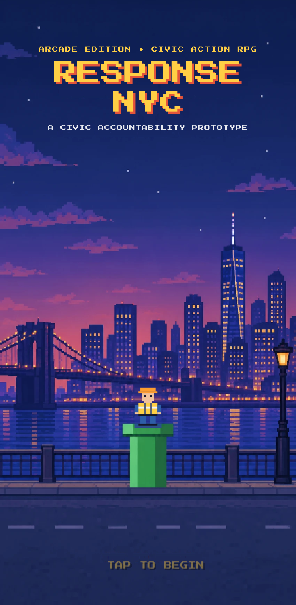

# ResponseNYC

**A civic accountability app for New York City, built as a retro arcade game.**

Viral posts get potholes fixed in hours; an ordinary 311 report takes days. ResponseNYC makes that gap measurable.



---

## The problem

A New Yorker filmed two potholes on his block, tagged the mayor, and came home to find both filled — two million views later. The city has repaired over 200,000 potholes this year, so the responsiveness is real. But there is no public way to tell whether a report gets fixed because the hazard is dangerous, or because the post did numbers.

The city's promises have the same problem. Fare-free buses, five hundred green schoolyards, Open Streets at every public school — announced once, then nothing follows up, so no one can tell which ones were kept.

ResponseNYC puts both in one place: what was reported, what got fixed, how fast, and what was promised but never delivered.

## What it does

**Map** — A pixel map of the five boroughs. Rather than pinning every complaint, which becomes visual noise, each borough carries a row of counters: red for reported, yellow for a crew on the way, green for fixed, plus a white counter for reports that went viral. Tapping a counter filters the list below to exactly those reports.

**Stats** — Every report stores two timestamps, filed and closed, so the app calculates response times and sets viral reports beside ordinary ones of the same kind.

**News** — Toggles between `DELIVERED` and `PROMISED`. Delivered lists completed city work; Promised lists outstanding commitments with their status. Every entry links out to the city's own posting.

**Report** — File a hazard and it drops onto the map as a new counter in your borough.

A `HOW TO PLAY` walkthrough runs on first launch, added after user testing showed people couldn't tell what the borough counters did. It's replayable from the `?` button in the header.

## A note on the data

The distinction matters, so it's stated in the app too:

- **Real, with source links** — every item in the News tab, the promises (sourced from the public Mamdani promise tracker), and the two internet-famous reports, including the original TikTok.
- **Illustrative** — the individual street-level reports on the map. The app was first built against the live [NYC 311 Open Data feed](https://data.cityofnewyork.us/Social-Services/311-Service-Requests-from-2010-to-Present/erm2-nwe9) and verified working; fixed data was substituted so demos don't depend on the API being up. Running live again is the first item on the 2.0 list.

## Privacy

The app collects nothing. No accounts, no login, no location tracking, no analytics, no third-party SDKs. Reports filed in the app live in memory for the session and are gone when it closes. The only thing written to disk is a single flag recording whether the walkthrough has been shown. There is no server, so nothing leaves the device.

## Running it

Requires macOS with Xcode 15 or later.

```bash
git clone https://github.com/<your-username>/ResponseNYC.git
cd ResponseNYC
open ResponseNYC.xcodeproj
```

Pick any iPhone simulator and press Run. There is no configuration, no API key, and no network dependency.

To regenerate the Xcode project from `project.yml` instead, install [XcodeGen](https://github.com/yonaskolb/XcodeGen) and run `xcodegen generate`.

## Built with

- **Swift + SwiftUI** — the entire app. Every screen, all custom controls, the pixel rendering via SwiftUI `Canvas`, and the animations. No third-party runtime dependencies.
- **Python + Pillow** — asset pipeline used during development to rasterize the borough map, strip baked-in labels from source artwork, and cut the animated boat sprites with transparency.
- **XcodeGen** — generates the Xcode project from `project.yml`.
- **[Press Start 2P](https://fonts.google.com/specimen/Press+Start+2P)** by CodeMan38 — the pixel typeface, SIL Open Font License.

## Attribution

The concept, design direction, artwork, product decisions and user testing are mine. **The code was written by AI** — Claude, via Claude Code — including the Swift/SwiftUI source and the Python asset scripts. I directed the build and made the decisions about what it should do; I did not write the implementation.

This is stated plainly because the project is public and credit should be accurate.

## Licence

MIT — see [LICENSE](LICENSE).
